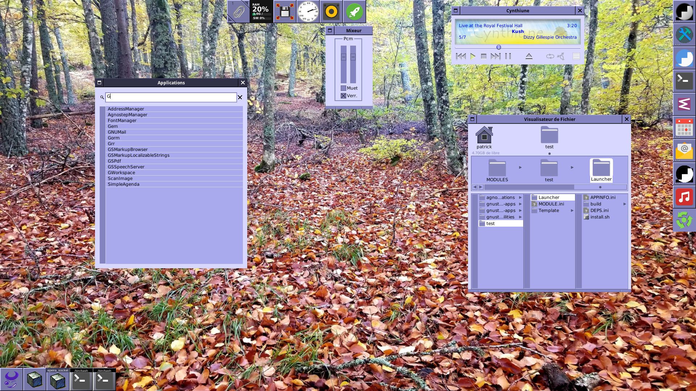

# Launcher

AGNoStep  -  Apps
(c) 2026 - Patrick Cardona

Thanks for the GNUstep Developers Community.  
This is Free and Open Source software.  
Read License in the root directory.

## What is Launcher

An Application launcher with filter.



## Install

You must have superuser privileges to type your password
when asked.

1. Run [agnostep-apps-manager](../../../agnostep-apps-manager)
2. Select category: *agnostep-applications*
3. Select application: *Launcher*
4. read info.
5. Confirm installation.

## Using

```
openapp Launcher
```

Or run it from the `Applications` folder.

Then type some letters in the filter, and finally click on an Application name in the filtered list to run it.

>[!TIP]
> The best way to use Launcher is to stick its icon onto the Clip or the Dock.

## AI disclaimer

- Code was suggested and improved with some AI Help, then read, tested and approved by a human being.
